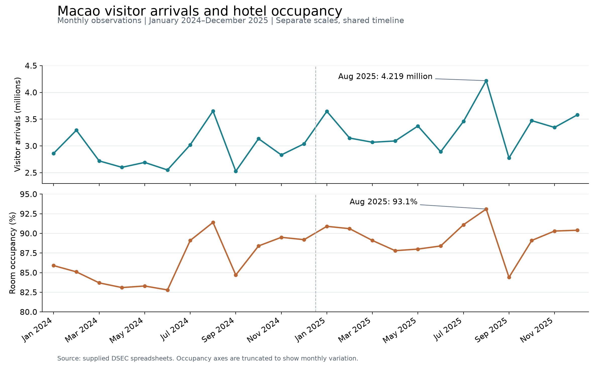
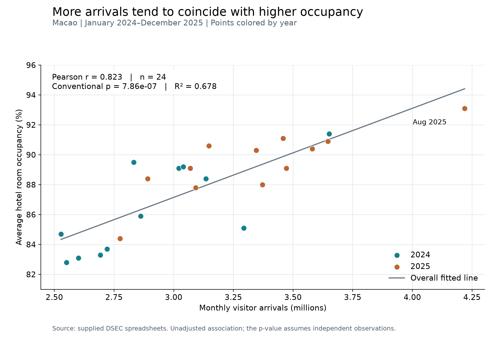

# CISC7204 Assignment 01 — Macao Visitor Arrivals and Hotel Occupancy

This repository presents my Assignment 01 portfolio work for **CISC7204 Data Science and Data Visualization** at the University of Macau.

## Project overview

The project examines monthly visitor arrivals and the average hotel room occupancy rate in Macao from January 2024 to December 2025. It asks:

> Is there a statistically significant positive association between monthly visitor arrivals and the average hotel room occupancy rate in Macao? Do months with more arrivals tend to have higher occupancy?

The analysis uses two public monthly series published by the [Statistics and Census Service (DSEC), Macao SAR Government](https://www.dsec.gov.mo/). The final merged dataset contains 24 complete monthly observations.

## Key findings

- Visitor arrivals ranged from 2,528,011 to 4,219,034 per month.
- Average hotel room occupancy ranged from 82.8% to 93.1%.
- The Pearson correlation was **r = 0.823** (**n = 24**, conventional two-sided **p < 0.001**).
- Visitor arrivals and occupancy moved in the same direction in 17 of the 23 month-to-month transitions.

The results indicate a strong positive association during the study period, but they do not establish causation. Seasonality, hotel room supply, special events, same-day visitors, and dependence between consecutive months are important limitations.

## Visualizations

### Monthly trends



The two aligned panels use separate scales so that peaks and dips can be compared without mixing unlike units.

### Relationship between arrivals and occupancy



Each point represents one month. Colors distinguish 2024 and 2025, and the fitted line summarizes the overall association.

## Repository contents

```text
.
├── README.md
├── CISC7204-Assgn01-PreliminaryProjectProposal.docx
├── CISC7204-Assgn01-PreliminaryProjectProposal.pdf
├── Macao_reviewed.ipynb
├── 入境旅客总数（202401-202512）.xls
├── 酒店入住率（202401-202512）.xlsx
├── monthly_data_2024_2025.csv
├── monthly_trends.png
├── arrivals_vs_occupancy.png
└── requirements.txt
```

- The two spreadsheets are archived DSEC source exports.
- `Macao_reviewed.ipynb` reads the source files, validates and merges the observations, computes the statistics, and recreates both figures.
- `monthly_data_2024_2025.csv` is the validated 24-row analysis dataset.
- The Word document is the submitted Assignment 01 preliminary project proposal; the PDF copy is included for convenient in-browser review.

## Reproduce the analysis

Python 3.10 or later is recommended.

```bash
python3 -m venv .venv
source .venv/bin/activate
python -m pip install -r requirements.txt
jupyter notebook Macao_reviewed.ipynb
```

In Jupyter, select **Kernel → Restart Kernel and Run All Cells**. The notebook should recreate the merged CSV and both PNG figures from the two archived source files.

## Data sources

- [DSEC Visitor Arrivals time-series database](https://www.dsec.gov.mo/timeseriesdatabase.aspx?keyindicatorid=27&lang=en-US) — total monthly visitor arrivals (persons).
- [DSEC Hotel Occupancy time-series database](https://www.dsec.gov.mo/timeseriesdatabase.aspx?keyindicatorid=9&lang=en-US) — monthly average room occupancy rate (%).

The repository contains public, aggregate statistics and no personal data. DSEC is identified as the source in the project documentation and figures.

## Authorship and collaboration

The Assignment 01 submission identifies **CHEN RUXIN** and **XIE ZIQI** as project members. Chen Ruxin contributed data collection, report writing, and document formatting; Xie Ziqi contributed topic exploration and data analysis. Both members finalized the research question, reviewed the visualizations, checked the interpretation, and approved the submission.

This portfolio repository is published under Chen Ruxin's GitHub account to document the coursework accurately; it does not claim sole authorship of collaborative work.

## Relationship to Assignment 02

Assignment 02 revised and expanded the pair project proposal for the same research question. It is documented separately so that each bonus-work URL clearly corresponds to the correct coursework item.
